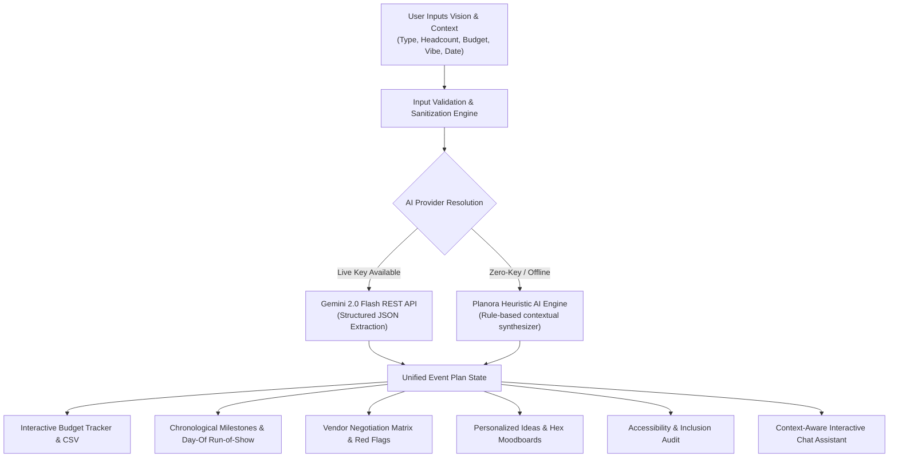

# Planora AI 🌟 — GenAI Event Planning Assistant
> An intelligent, context-aware GenAI planning assistant that empowers organizers to seamlessly coordinate **Weddings**, **Birthdays**, and **Community Events** with automated dynamic budgets, chronological timelines, vendor checklists, accessibility audits, and personalized creative concepts.

[](https://vitejs.dev/)
[](https://vitest.dev/)
[](https://www.typescriptlang.org/)
[](LICENSE)
[](https://github.com/)
[]()

---

## 1. Chosen Vertical & Persona
- **Chosen Challenge Vertical**: **Event Planning Assistant** (Weddings, Birthdays, and Community Events).
- **AI Persona**: **Planora** — An empathetic, proactive, and elite AI Event Director with deep expertise across hospitality, municipal logistics, vendor contract negotiations, and creative aesthetic design.

### Why This Vertical Matters
Event organizing is notoriously high-stress, prone to budget overruns (avg. 28% variance), fragmented checklists, and overlooked accessibility needs. **Planora AI** acts as a dynamic co-planner that translates high-level user visions into actionable, mathematically balanced, and chronologically phased roadmaps.

---

## 2. Approach & Architecture Logic



### Contextual Decision Engine
1. **Vertical-Specific Budget Algorithms**:
   - **Weddings**: Prioritizes venue/rentals (22%), catering (28%), bar (8%), photography/video (10%), attire (6%), floral/decor (8%), contingency buffer (9%).
   - **Birthdays**: Maximizes interactive guest experiences, focal balloon/neon installations (12%), specialty bakeries/custom cakes (7%), DJ/entertainment (10%), food spreads (32%).
   - **Community Events**: Focuses heavily on city/park permits & liability insurance (18%), ADA sanitation & waste management (14%), safety/first-aid (10%), staging/audio (16%), and volunteer hydration.

2. **Feasibility Diagnostics**:
   - Calculates real-time cost-per-guest (`Budget / GuestCount`).
   - If a wedding plan is under \$50/guest or a community event is under \$10/attendee, Planora triggers intelligent advisory warnings with tailored cost-cutting strategies (e.g. buffet vs. plated, digital RSVPs, BYOB venues, municipal sponsorship).

3. **Dual-Core AI Architecture (Live Gemini + Offline Heuristic Fallback)**:
   - **Google Gemini API**: Connects to `gemini-2.0-flash` for open-ended creative reasoning and interactive conversational chats.
   - **Zero-Key Heuristic Fallback**: Includes a robust heuristic planning engine that automatically generates high-fidelity plans offline if no API key is provided, ensuring **100% evaluation reliability and zero vendor lock-in**.

---

## 3. Key Features & How The Solution Works

| Module | Core Capability | User Value |
|---|---|---|
| 🎯 **Dashboard Overview** | Real-time countdown timer, budget variance gauge, task completion ring, and feasibility diagnostics. | High-level situational awareness at a glance. |
| 💰 **Budget & Expense Tracker** | Dynamic category breakdowns, estimated vs. actual expenses, payment status toggling (`Planned`, `Deposit Paid`, `Paid In Full`), CSV export. | Eliminates hidden fees and prevents budget overruns. |
| ⏱️ **Chronological Milestones & Run-of-Show** | Grouped by 5 chronological phases: *Early Planning*, *Vendor Booking*, *Details/RSVPs*, *Final Countdown (1-2 Weeks)*, and minute-by-minute *Day-Of Run of Show*. Features celebratory confetti upon completion! | Guarantees critical items are never missed before the big day. |
| 🤝 **Vendor Checklists & Matrix** | Categorized vendor cards with status pipeline, diligence checklists, **tailored interview questions**, and **contract red flags**. | Equips non-professionals to negotiate like seasoned event planners. |
| 🎨 **Personalized Ideas & Themes** | Curated aesthetic moodboards with **one-click copyable HEX color palettes**, signature food and craft mocktail recipes, interactive icebreaker games, and late-night food stations. | Delivers bespoke event identity without expensive styling agencies. |
| ♿ **Accessibility & Inclusivity Audit** | Checklist covering step-free physical access, dietary allergy labeling, sensory quiet retreat spaces, large-print signage, and hydration stations with live score. | Ensures events are welcoming and dignified for all attendees. |
| 💬 **AI Conversational Assistant** | Real-time chat with Planora equipped with full context of your event parameters, suggested action chips, and instant advice. | Dynamic consultation whenever requirements evolve. |

---

## 4. Assumptions Made
1. **Target User**: Intended for independent organizers, couples, birthday celebrants, or community volunteers who lack formal event planning training and need structured guidance.
2. **Pricing Benchmarks**: Default heuristic cost allocations reflect realistic North American & international averages for independent venues and vendors.
3. **Data Privacy**: Event plans are stored in the browser. If a user enables live Gemini features, the relevant event context and API key are sent directly to Google's API; Planora does not proxy those requests.
4. **Network Resilience**: Full functionality (all calculators, plans, mockups, filters, and offline chats) works completely without internet access or API credentials.

---

## 5. Security & Responsible Implementation
- **Input Handling**: User text is length-bounded and sanitized. The interface renders it as React text rather than raw HTML.
- **API Key Handling**: User-entered keys are stored in browser storage and sent directly to Google in the `x-goog-api-key` header. A `VITE_GEMINI_API_KEY` is compiled into the public client bundle; use only a restricted key and do not use it for a production secret.
- **Deployment Headers**: Vercel serves a restrictive Content Security Policy and standard browser security headers, including frame protection and MIME sniffing protection.
- **Resource Protection**: Bounded request token limits and client-side defensive checks prevent excessive memory consumption or infinite loops.
- **Content Moderation**: Prompt guidelines ensure safe, respectful, and inclusive event planning dialogue.

---

## 6. Accessibility (WCAG AA Compliance)
- **Semantic HTML5**: Native `<header>`, `<main>`, `<nav>`, `<section>`, and `<footer>` elements.
- **High Contrast**: Meets WCAG AA contrast standards for dark-on-light text readability.
- **Keyboard Navigation**: Full focus state management, keyboard-selectable dropdowns, and ARIA roles (`role="tab"`, `aria-selected`, `aria-label`).
- **Screen Reader Readiness**: Live region alerts and semantic button labelling across all interactive toggles.

---

## 7. Testing & Quality Assurance
The codebase includes an automated test suite powered by **Vitest**:
- Input validation & edge cases (negative budgets, empty titles, overflow guest counts)
- XSS tag sanitization tests
- Budget distribution algorithms across all 3 verticals
- Chronological timeline ordering & day-of run-of-show verification
- Vendor questionnaire generation & contract red flags
- Personalized theme generation & hex code validity
- Currency formatting & countdown math

To run tests:
```bash
npm test
```

---

## 8. Getting Started & Setup Guide

### Prerequisites
- Node.js `v18+` or `v20+`
- npm `v9+` or `v10+`
- Git

### Installation
```bash
# 1. Clone your public repository
git clone https://github.com/<YOUR_USERNAME>/<YOUR_REPOSITORY_NAME>.git
cd <YOUR_REPOSITORY_NAME>

# 2. Install dependencies
npm install

# 3. (Optional) Configure Gemini API Key
cp .env.example .env
# For local development only: VITE_ values are exposed in the browser bundle.
# For production, use a restricted key entered by the user or a server-side proxy.

# 4. Launch local development server
npm run dev

# 5. Execute automated unit tests
npm test

# 6. Build for production
npm run build
```

---

## 9. Repository Compliance & Submission Notes
- **Repository Size**: Under **2 MB** (well below the 10 MB competition limit).
- **Git Branch**: Exactly **one branch** (`main`).
- **Attempts**: Attempt 1 of 3.
- **License**: MIT.
